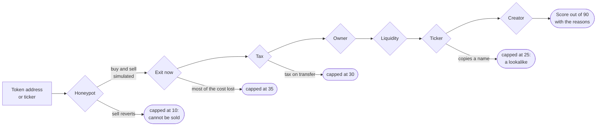
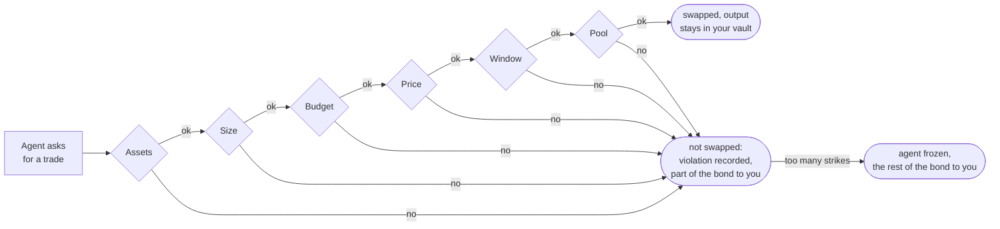

<p align="center">
  <a href="https://corbel.finance"></a>
</p>

<h3 align="center">The all-in-one app for Robinhood Chain</h3>
<p align="center"><i>Check it. Swap it. Earn on it. Let an agent trade it, inside rules a contract enforces.</i></p>

<p align="center">
  <a href="LICENSE"></a>
  
  <a href="packages/mcp"></a>
  <a href="docs/CONTRACTS.md"></a>
  
  
</p>

<p align="center">
  <a href="https://corbel.finance"><b>corbel.finance</b></a> ·
  <a href="https://corbel.finance/app/trust/check">Check a token</a> ·
  <a href="https://corbel.finance/docs">Docs</a> ·
  <a href="docs/TRUST_ENGINE.md">Trust engine</a> ·
  <a href="docs/CONTRACTS.md">Contracts</a> ·
  <a href="https://x.com/corbelfinance">X</a> ·
  <a href="https://t.me/corbelfinance">Telegram</a>
</p>

---

On a new chain most tokens are launched to be sold to you. A green chart says nothing about whether you can sell back,
who can mint, or who holds the supply. And once you hand a trading bot your wallet, nothing stops it from spending all
of it.

**Corbel reads the chain before you sign.** A token is bought and sold inside a simulation of the live pool at the
latest block, then read seven ways. Every check answers with a reason, the reasons add up to one score out of 90, and
some findings cap the score whatever the rest says. Nothing is signed, nothing is sent.



| Check | Asks | Flags when |
|---|---|---|
| **Honeypot** | Can a buy be sold back right now? | the simulated sell reverts, or the buy itself is refused |
| **Exit now** | What does a buyer-size bag get back? | a sale returns under half of what it cost |
| **Tax** | How much do buy and sell take? | a token-level tax eats part of each trade |
| **Owner** | Who can change the rules? | a live owner can mint, pause, blacklist or switch fees, or the code can be replaced |
| **Liquidity** | Can the pool be pulled? | the LP is not burned or locked, or the pool is thin |
| **Ticker** | Is this the token it claims to be? | it copies another token's name, or a stock token that is not the issuer's code |
| **Creator** | What did this wallet launch before? | many launches, most of them drained |

The score is weighted by what was measured, not only pass or fail: Exit 35%, Holders 20%, Control 20%, Liquidity 15%,
Origin 10%. A part with no data is left out and the rest are re-weighted, so a missing read never counts as a pass. No
token scores 100: the ceiling is 90. The whole method is in **[docs/TRUST_ENGINE.md](docs/TRUST_ENGINE.md)**.

## What a check answers

Every check comes back as a row a person can act on. An example answer from `GET /api/token?q=<address>`:

```jsonc
{
  "token": "0x…",
  "checks": [
    { "id": "honeypot", "name": "Honeypot",      "result": "pass", "reason": "Bought and sold back in a simulation on the Uniswap v4 pool.", "metric": "−0.6% round trip" },
    { "id": "exit",     "name": "Exit now",      "result": "warn", "reason": "Selling a buyer-size bag right now returns under half its cost: the pool is lopsided.", "metric": "41.2% of cost back" },
    { "id": "owner",    "name": "Owner rights",  "result": "pass", "reason": "Ownership renounced." },
    { "id": "ticker",   "name": "Ticker vs contract", "result": "warn", "reason": "2 other contracts also use this ticker. Check the address, not the ticker." }
  ],
  "meta": { "symbol": "…", "venue": "v4", "block": "…", "ms": 4800 }
}
```

## Agents that cannot run away with the money

An agent trades your funds from a vault only inside a mandate you write. It posts a USDG bond before its first trade.
Every trade is checked by the contract, rule by rule; a trade that breaks one is not swapped, and the agent pays for
trying.



| Rule | Asks | Refuses when |
|---|---|---|
| **Assets** | Are both sides on your list? | either token is not listed |
| **Size** | Is this one trade small enough? | the input is over your per-trade cap |
| **Budget** | Is there room left today? | the day's total (UTC) would pass your daily cap |
| **Price** | Is the price fair? | V2: less out than the pool's own quote minus your slippage; v4: a fee over 1% or a hook you did not approve |
| **Window** | Is it allowed now? | outside your hours or weekdays, or before the cooldown ends |
| **Pool** | Is it a pool you approved, near your price mark? | an unapproved pool, or one pushed away from your mark |

Only you withdraw. The agent can never move funds out of the vault, and your withdrawal never touches its bond.

| | You (owner) | Agent | Anyone else |
|---|---|---|---|
| Deposit | ✅ | — | ✅ (it's just a transfer) |
| **Withdraw** | ✅ any time | ❌ never | ❌ |
| Trade inside the mandate | ❌ | ✅ only within your rules | ❌ |
| Change rules, revoke the agent | ✅ | ❌ | ❌ |
| Post or unbond the bond | — | ✅ (unbond after a delay) | ❌ |

## What you can do

| | Section | What it does |
|---|---|---|
| 01 | **Check** | The seven checks and the score; what happened to every new pool; how much volume is bots; whether buyers still hold; every token one wallet launched; how accurate the check has been. |
| 02 | **Trade** | Every route (V2, v4, two hops through ETH or USDG) quoted at the latest block. Paper trading with no wallet. Limit, take profit, stop, DCA and TWAP orders that open the swap for your wallet to sign. Sell many small holdings at once. |
| 03 | **Earn** | Pool fees and positions with what each pool actually paid, and the token check run before a deposit. |
| 04 | **Wallet** | Which contracts can move your tokens, and a one-transaction revoke you sign. |
| 05 | **Agents** | Bonded agents inside a mandate, an agent wallet made in your browser, rules drafted from your practice trades, a survival league. |
| 06 | **AI & GPUs** | Text, image, film and sound models in one chat after a wallet sign-in, with more for $CORBEL holders. |

Corbel never asks for a key or a seed phrase. Everything a wallet signs is shown in plain words before it is signed.

## Use it from your agent

`packages/mcp` is a dependency-free MCP server with read-only tools. It never signs or sends anything.

```bash
node --experimental-strip-types packages/mcp/src/server.ts
```

| Tool | What it answers |
|---|---|
| `trust_check` | The seven checks on a token, by address or ticker |
| `quote` | Every route simulated at the latest block: amount out, gas, price impact |
| `trade_guard` | May the agent make this trade under its owner's policy? Allow or deny, with each rule's result |
| `radar` | The newest pools, with the launcher's pool count and whether the pool is drained |
| `mandate_scenarios` | The attacks the mandate lab can run |
| `mandate_try` | Runs one attack against a real mandate inside a simulation of the live chain: which rule stopped it, what bond it lost |

## Contracts (Robinhood Chain, chain ID 4663)

Solidity 0.8.26, via-IR, no external libraries. **Not audited.** Reviewed in-house, demo amounts only. Every live
contract is verified on Blockscout.

| Contract | Status | What it guarantees |
|---|---|---|
| `CorbelPredict` | **Live** [`0x6223…73d9`](https://robinhoodchain.blockscout.com/address/0x62230624777b012a316e365c7ab3677159cd73d9) | YES/NO markets in USDG, settled from the chain alone: survival by the pool's lowest reserve, price by the pool's own time-weighted average. No resolver. An empty side, a missed window or a stalled settlement refunds everyone. |
| `CorbelMandates` / `CorbelMandate` | **Live** [`0xdea0…4d36`](https://robinhoodchain.blockscout.com/address/0xdea049d3e6df029afe5542d95428ea057f2d4d36) | The six rules above, the bond, the slash and the freeze. The owner can replace a bonded agent at any time; the bond goes back to it. |
| `CorbelAgentVault` | Not deployed | A bot trades inside caps and only through pairs the owner approved; it can never withdraw. |
| `CorbelOrders` | Not deployed | Limit, DCA and TWAP as one primitive. Input escrowed; output straight to the owner, with a floor per slice. |
| `CorbelLaunch` | Not deployed | Fixed supply, no owner, no mint, no tax. The v4 pool is guarded until graduation; if the target is missed, everyone sells back with no fee. |
| `CorbelVault` | Not deployed | ERC-4626 over USDG. Withdrawals can never be paused. No admin withdraw, sweep or upgrade. |

<details>
<summary><b>Security fixes from the 2026-11-20 public review</b></summary>

| Finding | Fix | Where |
|---|---|---|
| A bonded agent could route through its own pools and take the daily budget | The Pool rule: owner-approved pools, price held to the owner's mark | live in `0xdea0…4d36`; refused on mainnet: [tx](https://robinhoodchain.blockscout.com/tx/0xffbc4d37dc2f4d9a97fc8d93532b227f7307994b1cff597d758e3dd6f63a66b2) |
| Same in `CorbelAgentVault` | Owner-approved pairs and price mark | in the source (not deployed) |
| The owner could not revoke a bonded agent | `setAgent` works at any time; the old agent's bond goes back to it | live in `0xdea0…4d36`; on mainnet: [tx](https://robinhoodchain.blockscout.com/tx/0xb624936c903bcffe89b0263ffbd981718e6455083575d33f3045dd1b3f7ef4ea) |
| A launch could be blocked by pre-seeding its v4 pool | `CorbelLaunchGate` hook: only the sale opens the pool before graduation | in the source (not deployed) |
| The Predict resolver proposed outcomes and ruled on challenges to them | Resolver removed: price markets settle from the pool's TWAP | live in `0x6223…73d9` |
| `packages/data` and the contract scripts were missing; the build failed | Included; a clean clone typechecks and builds | in the source |

Retired: the first CorbelPredict (`0x2AC3…0f63`) and three earlier mandate factories (`0x5d4e…de04`, `0x4845…1d81d`,
`0xe855…c30b`). Their mandates have every asset unlisted and the owner's funds withdrawn.

</details>

Full reference: **[docs/CONTRACTS.md](docs/CONTRACTS.md)**.

## Run it yourself

Requires Node.js 22+ and pnpm.

```bash
pnpm install
cp .env.example apps/web/.env.local   # chain reads stay off until CHAIN_READS=1
pnpm dev                              # http://localhost:3000
```

The site runs without any keys. Chain reads, the AI chat and media need their own settings in `apps/web/.env.local`;
without them those parts stay off and everything else works.

```bash
pnpm lint && pnpm typecheck && pnpm test && pnpm build   # site and packages
pnpm --filter @corbel/web exec playwright test           # end-to-end, with accessibility checks
pnpm --filter @corbel/contracts test:contracts           # contracts, local, no network
```

## What is here

| Folder | What |
|---|---|
| [`apps/web/`](apps/web) | The site and the app (Next.js 16, React, Tailwind 4): API routes for checks, quotes, holders, pools and wallet sign-in; every tool in `components/app/` |
| [`packages/data/`](packages/data) | The trust report: the buy-and-sell simulation, owner powers, liquidity locks, schemas |
| [`packages/contracts/`](packages/contracts) | Solidity contracts, tests and verification inputs |
| [`packages/mcp/`](packages/mcp) | The read-only MCP server for agents |
| [`packages/indexer/`](packages/indexer) | A small log indexer for launches and pools |
| [`packages/config/`](packages/config) | Brand, chain, flags, facts and every line of copy |
| [`packages/ui/`](packages/ui) | Design tokens and primitives |
| [`docs/`](docs) | [Trust engine](docs/TRUST_ENGINE.md), [contracts](docs/CONTRACTS.md), [chain notes](docs/CHAIN_FIELD.md), [copy rules](docs/COPY_RULES.md) |

## Status

Beta, on Robinhood Chain mainnet. Two contracts are live with demo amounts; the rest are in the source and not
deployed. Nothing here is audited. A clean check is not a guarantee: it reads the chain, not intent.

## Security

Found a problem? Write to **contact@corbel.finance**. Please do not open a public issue for a vulnerability.

## License

[MIT](LICENSE)
